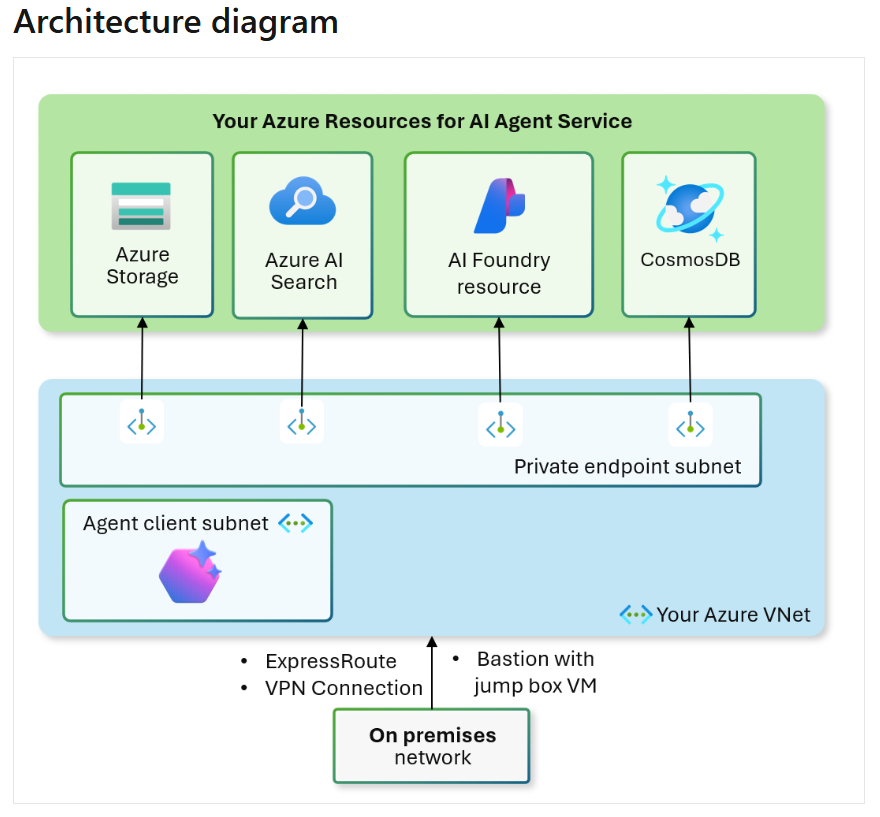

# Application Landing Zone — Microsoft Foundry (BYO VNet)

This is an optional application landing zone. It deploys Microsoft Foundry with Agent Service and private endpoints into its own spoke VNet. The module creates the VNet, subnets, and hub connection. You do not need to deploy this to use the Networking module on its own.

This module is based on the [validated Terraform sample](https://github.com/microsoft-foundry/foundry-samples/tree/main/infrastructure/infrastructure-setup-terraform/15b-private-network-standard-agent-setup-byovnet), modified to pull network dependencies from the platform landing zone via `terraform_remote_state`.

"Secure" refers to the use of private endpoints. Local auth (API keys) is disabled on AI Search and Cosmos DB when the agent data services are deployed. The Foundry account keeps `disableLocalAuth = false`, which the Agent proxy requires for internal communication over a BYO VNet. If a tenant governance policy forces local auth off or disables storage public network access at create time, Terraform ignores those two properties instead of fighting the policy on every plan.

The template follows the [documented architecture](https://learn.microsoft.com/en-us/azure/ai-foundry/agents/how-to/virtual-networks) for Microsoft Foundry Standard Setup with private networking (BYO VNet).



## Prerequisites

- All [platform landing zone prerequisites](../README.md#prerequisites)
- Platform Landing Zone (`Networking/`) applied first
- Private DNS zones enabled (`add_private_dns00 = true` in Networking)
- Azure region with AI Foundry support and quota
- For a second region, see [Region 1](#region-1)

## Quick Start

```sh
cd Foundry-byoVnet
terraform init && terraform apply
```

**Prerequisites:** Networking module must be applied first with `add_private_dns00 = true`.

## Upgrading an existing deployment

⚠️ This version moves every resource into `modules/foundry-region/` and adds the region abbreviation to the Foundry account and data service names. Terraform cannot carry an earlier deployment forward. Run `terraform destroy` with the version you deployed, finish the [cleanup](#cleanup) steps, then apply this version.

The three address variables (`ai_vnet_address_space`, `ai_foundry_subnet_address`, `private_endpoint_subnet_address`) are replaced by `regional_networks`. Terraform only warns about undeclared variables in `terraform.tfvars`, so move any custom prefixes into `regional_networks.region0` before applying, or the defaults are used.

## Variables

This module creates its own VNet with subnets and hub connection per region. Customize networking and deployment names, or use defaults.

| Variable                     | Default                    | Purpose                                         |
| ---------------------------- | --------------------------- | ----------------------------------------------- |
| `resource_group_name_ai00`   | `"rg-ai00"`                | Resource group base name                        |
| `deploy_region1`             | `false`                    | Deploy a second stack in Networking region 1    |
| `regional_networks`          | See below                  | Per-region VNet and subnet address prefixes     |
| `deploy_agent_data_services` | `true`                     | Deploy BYO agent data services in every region  |

`regional_networks` defaults:

| Key       | VNet             | Foundry subnet   | Private endpoint subnet |
| --------- | ---------------- | ---------------- | ----------------------- |
| `region0` | `172.20.32.0/20` | `172.20.32.0/26` | `172.20.33.0/24`        |
| `region1` | `172.21.32.0/20` | `172.21.32.0/26` | `172.21.33.0/24`        |

Overriding `regional_networks` replaces the whole map, so include `region0` and, when `deploy_region1 = true`, `region1`. See `docs/ip-addressing.md` before changing prefixes.

For GPT deployment names, SKUs, and other service config, see `variables.tf`. Model, SKU, and data service settings apply to every deployed region.

### Region 1

Region 0 always deploys. Set `deploy_region1 = true` to add a second, independent stack in Networking region 1. It gets its own resource group, spoke VNet, hub connection, Foundry account, project, model deployment, private endpoints, and, when enabled, data services.

Region 1 requires:

- Networking applied with `create_vhub01 = true` and `add_private_dns01 = true`
- A region 1 Azure region that supports Foundry Agent Service with BYO VNet injection
- Quota in region 1 for the configured model and SKU

If Networking region 1 is missing, `terraform plan` fails with a message naming the Networking variables to set. Networking region 1 on its own does not deploy a second Foundry stack. This module only uses it when `deploy_region1 = true`.

Each stack resolves private endpoints through its own region's Private DNS. A client in region 0 cannot resolve the region 1 Foundry endpoint, so test region 1 from the region 1 test VM. The two stacks share no state and do not fail over.

Region 1 roughly doubles the module's cost. With data services enabled, it adds a second AI Search service, Cosmos DB account, and Storage account.

### Agent data services

By default the module deploys its own Azure Storage, Cosmos DB, and AI Search, and the project capability host points agent data at them.

Set `deploy_agent_data_services = false` to omit all three, along with their private endpoints, project connections, role assignments, and diagnostic settings. Foundry Agent Service then uses Microsoft-managed storage for conversation history, file uploads, and vector data.

The module remains a bring-your-own virtual network deployment in both modes. The Foundry account, its network injection, the project, the model deployment, and the private endpoint are unchanged.

The module waits three minutes after creating or replacing the Foundry account before it creates the account's private endpoint. The account reports a finished create while its provisioning state is still `Accepted`, and an endpoint created during that window fails with `AccountProvisioningStateInvalid`. In the default mode, the wait runs in parallel with the sequential data service endpoints.

Capability hosts cannot be updated in place, so pick a value before you deploy. Changing it on a live deployment requires `terraform destroy` first.

## Outputs

`foundry_regions` is a map keyed by `region0` and, when deployed, `region1`. Each entry has:

| Field                    | Purpose                                                                                 |
| ------------------------ | --------------------------------------------------------------------------------------- |
| `region_name`            | Azure region name                                                                       |
| `region_abbr`            | Region abbreviation used in resource names                                              |
| `resource_group_id`      | Regional resource group ID                                                              |
| `foundry_id`             | Microsoft Foundry account ID                                                            |
| `foundry_endpoint`       | Foundry account endpoint (`properties.endpoint`, the `cognitiveservices.azure.com` URL) |
| `project_id`             | Microsoft Foundry project ID                                                            |
| `model_deployment_names` | Model deployment names in the account                                                   |
| `storage_account_id`     | Storage account ID, null when data services are disabled                                |
| `cosmosdb_account_id`    | Cosmos DB account ID, null when data services are disabled                              |
| `ai_search_id`           | AI Search service ID, null when data services are disabled |

## Cleanup

Destroy this module before Networking. Repeat the purge for every region you deployed.

⚠️ **Soft-delete gotcha:** After `terraform destroy`, each Foundry account enters soft-delete state with a `serviceassociationlink` to its region's AI subnet. You must purge every soft-deleted account before destroying Networking, or the subnet delete will fail. Wait ~10 minutes after each purge completes.

- [Purge a deleted resource](https://learn.microsoft.com/en-us/azure/ai-services/recover-purge-resources?tabs=azure-cli#purge-a-deleted-resource)

⚠️ **Orphaned Service Association Link:** Another issue could be an orphaned service association link (SAL). Each AI subnet uses a SAL to the Microsoft-managed environment behind the scenes, and the SAL is owned by the Microsoft backend. If you’re unable to delete an AI subnet due to an existing SAL, remove the service association from the subnet and wait 48-72 hours for the backend cleanup process to complete; then you should be able to delete the VNet.

## Security & Privacy — Foundry Trace Logs

> ⚠️ **PII Risk in Agent Traces**
>
> The Foundry project diagnostic setting captures Trace Logs via the `allLogs` category group. Per [Microsoft's documentation](https://learn.microsoft.com/azure/foundry/observability/how-to/trace-agent-setup#security-and-privacy), these traces may contain user inputs, model outputs, and tool arguments — i.e., sensitive content and PII. All trace data flows into the Log Analytics workspace, where it is queryable by anyone with `Log Analytics Reader` role.
>
> Before graduating this lab to production, review your data handling requirements. If PII handling is critical, consider excluding `Trace Logs` from the project diagnostic setting or restricting Log Analytics access via Azure RBAC.
